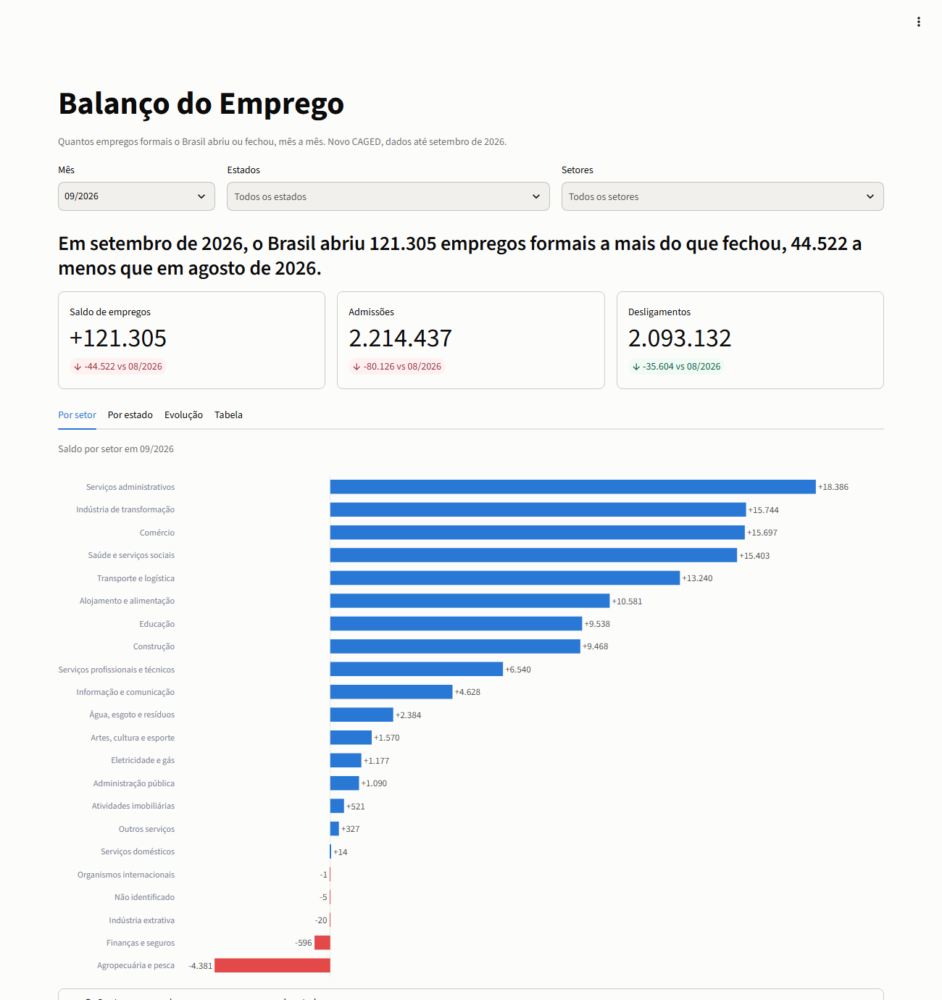
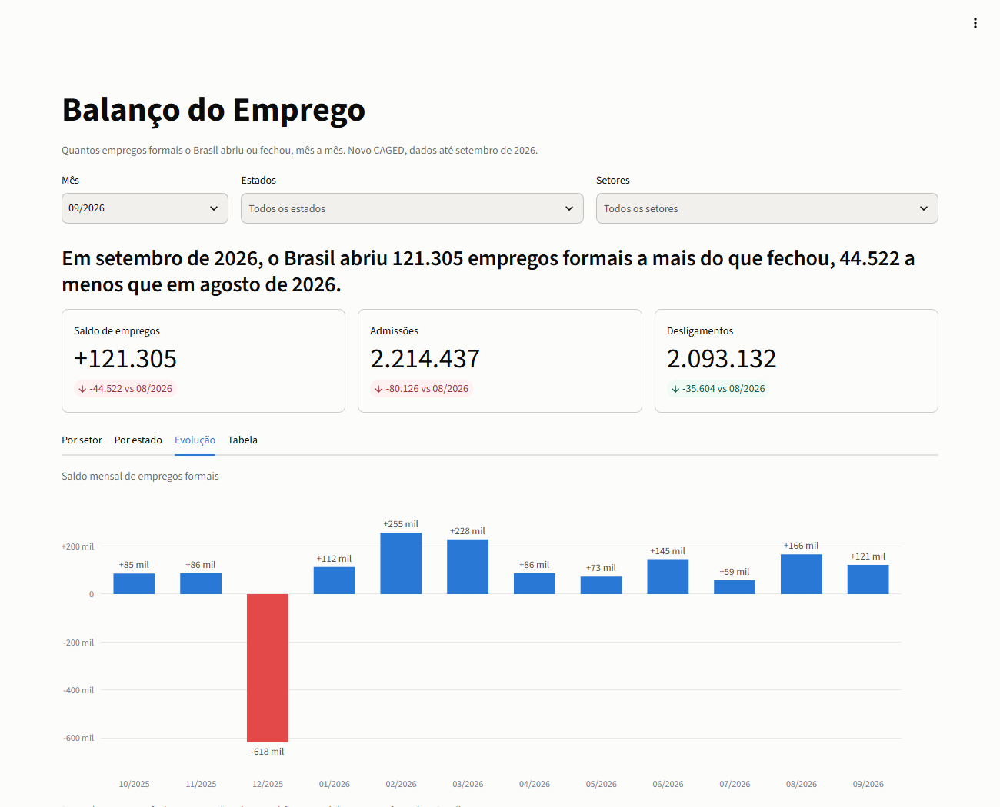

# Balanço do Emprego


Quantos empregos formais o Brasil abriu ou fechou, mês a mês. Um pipeline de dados públicos do
**Novo CAGED** (Ministério do Trabalho e Emprego): coleta automática, carga idempotente em Postgres,
indicadores em SQL e um painel em Streamlit.

**Painel online: https://balanco-emprego.streamlit.app**





## O que os dados mostram

Doze meses, de outubro de 2025 a setembro de 2026, cerca de 52,8 milhões de movimentações:

- O saldo do período foi de **+798.419 empregos formais**.
- **Dezembro de 2025** sozinho fechou em **−618.164**, um padrão sazonal do emprego formal. Sem ele, o
  saldo dos outros onze meses é de +1,42 milhão. O melhor mês foi fevereiro de 2026 (+255.321).
- Setores que mais geraram vagas: serviços administrativos (+187 mil), saúde (+148 mil) e
  transporte (+105 mil). O que mais perdeu: agropecuária (−22,9 mil), seguida da indústria de
  transformação (−5,4 mil).
- Estados: São Paulo (+159 mil), Rio de Janeiro (+95 mil) e Bahia (+71 mil) lideram. Tocantins foi o
  único com saldo negativo no período (−30), e Rondônia (+1,4 mil) mal saiu do zero.

Esses números são os mesmos que o Ministério divulga, como mostra a conferência abaixo.

## Como funciona

```
FTP do governo ─► pipeline/coleta.py ─► data/raw (.7z) ─► data/extracted (.txt)
                                                               │
   flows/carga_mensal.py (Prefect: retries, timeouts, agenda)  ▼
                                           pipeline/carga.py (COPY + validação, idempotente)
                                                               │
                                                      Postgres (movimentacao)
                                                               │
                                           mv_indicadores (materialized view)
                                                  │                      │
                                        app/app.py (Streamlit)    pipeline exportar ─► CSV (painel online)
```

| Peça | O que faz |
|---|---|
| `pipeline/coleta.py` | Baixa e extrai os arquivos mensais, sem rebaixar o que já existe e sem deixar arquivo incompleto |
| `pipeline/carga.py` | Carga idempotente por arquivo, numa transação, com validação dos códigos |
| `sql/schema`, `sql/views` | Dimensões, tabela de fatos e a view materializada que alimenta o painel |
| `flows/carga_mensal.py` | Flow do Prefect: só processa meses novos, com retries e agenda diária |
| `app/app.py` | Painel com filtros por mês, estado e setor |
| `sql/analises` | Cinco análises em SQL (CTEs e window functions) |

## Decisões de engenharia

**Idempotência e deduplicação por arquivo.** O arquivo do governo não tem identificador de linha, e
há movimentações idênticas (mesmos campos) que são eventos reais distintos, como duas admissões
iguais no mesmo dia. Deduplicar por linha apagaria admissões verdadeiras. Por isso a unidade é o
arquivo:

- `carga_arquivo` guarda o hash (sha256) de cada arquivo carregado (tipo + mês da declaração).
- Mesmo hash: a carga é pulada. Hash diferente (o governo republicou): apaga o arquivo antigo e
  reinsere, na mesma transação. Se algo falhar no meio, nada é gravado.
- Exclusões (`EXC`) entram com sinal invertido em `saldo_efetivo`, a coluna que as análises somam.

**Desempenho, medido antes de mexer.** A carga de um mês (4,4 milhões de linhas) caiu de 33 para 6
minutos. A primeira otimização, no Python, não adiantou. Medindo por etapa, o gargalo eram as chaves
estrangeiras da tabela de fatos: uma consulta por linha, 94 s contra 3 s para 500 mil linhas. Elas
foram trocadas por uma validação em lote dos códigos antes do `INSERT`, que aborta a carga se
aparecer um código fora do dicionário oficial.

**Dados ruins da fonte.** Um único registro de abril de 2026 trazia salário de 70,5 bilhões
(`7,05e+10`) e derrubava a carga. A linha é mantida, porque ainda conta para o saldo, e o salário
vai como `NULL`, com aviso no log. O mesmo vale para `horas_contratuais`.

**Falhas esperadas.** A extração é atômica (um `MemoryError` não deixa um `.txt` vazio que seria
reaproveitado na tentativa seguinte), o Prefect tenta de novo com espera crescente e o banco
reinicia sozinho se o Docker cair.

## Conferência com os números oficiais

O saldo do painel é o do arquivo de movimentações declaradas no prazo (`CAGEDMOV`), e bate **exatamente**
com os números divulgados pelo Ministério:

| Mês | Divulgado | Painel | Diferença |
|---|---|---|---|
| Dezembro de 2025 | −618.164 | −618.164 | 0 |
| Agosto de 2026 | +165.827 | +165.827 | 0 |
| Setembro de 2026 | +121.305 | +121.305 | 0 |

Os valores divulgados vêm de notícias que reproduzem os números do Ministério, não do painel oficial.

**Um erro que a conferência pegou.** A primeira versão somava também os arquivos de declarações fora do
prazo (`CAGEDFOR`) e de exclusões (`CAGEDEXC`) ao mês em que foram entregues. Esses arquivos trazem
ajustes de meses *anteriores* (nenhuma linha deles era do próprio mês), então o painel misturava
períodos e errava por até 7% (em março de 2026, 16.829 acima do certo). Os dois arquivos continuam no
banco, para quem quiser estudar as revisões, mas a view do painel só usa o `CAGEDMOV`.

## Rodando localmente

```bash
docker compose up -d                                   # Postgres (cria o schema na 1ª vez)
pip install -r requirements.txt
python -m pipeline.cli dimensoes tests/fixtures/layout.xlsx   # tabelas de apoio (dicionário oficial)
python -m pipeline.cli views                           # materialized view do painel
python -m flows.carga_mensal                           # baixa e carrega os últimos 12 meses
streamlit run app/app.py                               # painel em http://localhost:8501
pytest                                                 # testes
```

Para deixar a carga agendada (todo dia às 08:00, só carrega o que for novo):
`python -m flows.servir`.

## Painel online

A versão publicada (Streamlit Community Cloud) não tem banco: ela lê `app/dados/indicadores.csv`, um
recorte agregado (mês x estado x setor, 6.640 linhas, só números públicos) exportado do banco. O
painel tenta o banco primeiro e, se não conseguir, usa o arquivo. Os dados online ficam congelados
até alguém rodar a exportação e enviar o arquivo atualizado:

```bash
python -m pipeline.cli exportar              # a partir do banco (view mv_indicadores)
python -m pipeline.cli exportar-arquivos     # direto dos arquivos extraídos, sem banco nem Docker
```

Os dois caminhos dão o mesmo resultado, e um teste garante isso.

## Testes

Os testes rodam contra um Postgres real, com uma amostra de 1.000 linhas do arquivo de outubro de
2025 (`tests/fixtures`): idempotência, arquivo republicado, rollback em falha no meio da carga,
código fora do dicionário, salário absurdo, extração interrompida, equivalência entre a view e o CSV
sem banco, e o painel sem banco. O GitHub
Actions roda todos a cada push.
